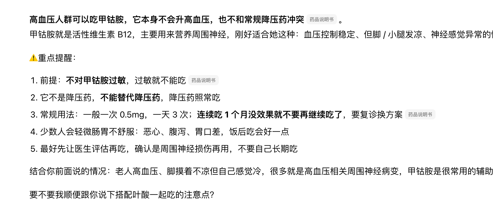
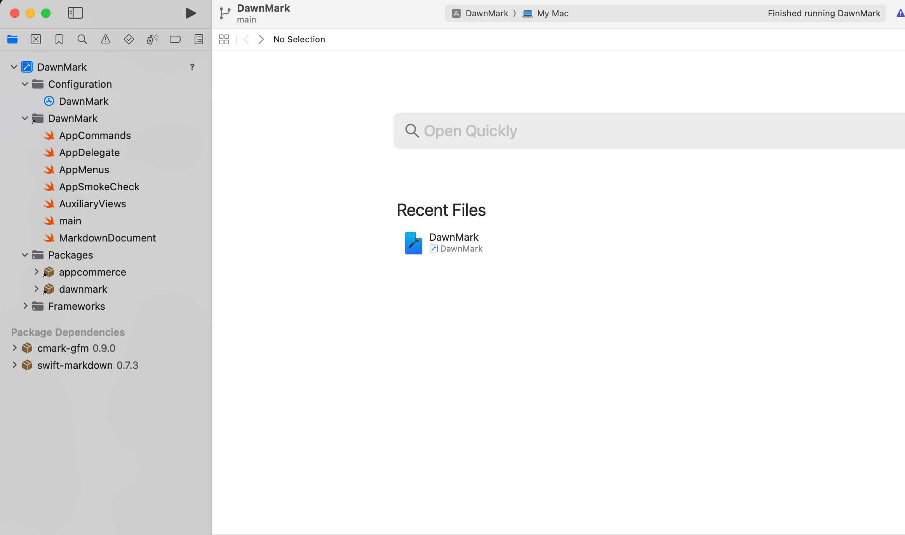
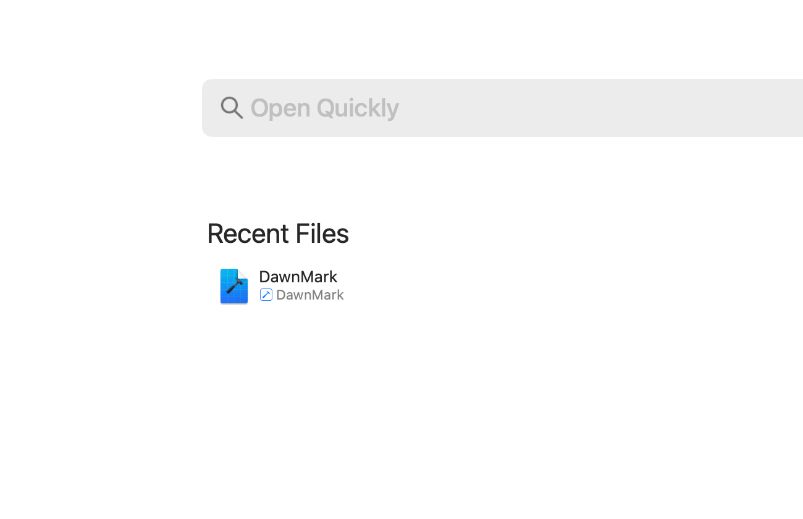

# 哈哈哈

你好

***

[等等](<https://baidu.com>)

|   |   |
| --- | --- |
|   |   |
|哈哈哈哈哈哈   |哈哈   |
```go
import "fmt"

func main() {
  return 0
}
```

yaml测试，，，，yaml测试，，，，yaml测试，，，yaml测试，，yaml测试，，，，yaml测试，，，yaml测试，，yaml测yaml测试，，，yaml测试，，yaml测试，，，，yaml测试，，，等等的点点滴
```yaml
apiVersion: apps/v1
kind: Deployment
metadata:
  name: rollout-demo-stable
  labels:
    app.kubernetes.io/name: rollout-demo
    track: stable
spec:
  replicas: 3
  selector:
    matchLabels:
      app.kubernetes.io/name: rollout-demo
      track: stable
  template:
    metadata:
      labels:
        app.kubernetes.io/name: rollout-demo
        track: stable
    spec:
      containers:
      - name: rollout-demo
        image: gcr.io/google-samples/hello-app:1.0
        ports:
        - containerPort: 8080
        env:
        - name: VERSION
          value: "v1"

```

Dockerfile测试：
```dockerfile
FROM python:3.12-slim
WORKDIR /app
COPY requirements.txt .
RUN pip install --no-cache-dir -r requirements.txt
COPY . .
EXPOSE 8000
CMD ["python", "app.py"]
```


[ok](<https://google.com>)

[haha](<https://baidu.com>)

|哈哈   |好的   |
| --- | --- |
|ok   |aaa   |

百度
[dddd](dddd)


##### 标题5
###### 标题6

**在一个明媚的早晨**

```
#include<stdio.h>

int main() {
    printf("hello\n")
}
```


		哈哈
	哈哈哈	
	    哈哈

	 乖乖 乖	哈哈

​        空格


1. 哈 哈哈
    1. 哈哈  ~~等等~~
3. 点*多到*
4. 点多到
5. 大
```
敌当
```
前



4. aaa *hello*a*aa*a
   


  点多 到

 点 多到

哈

*好的*
###### 那你哈哈哈
##### 就很好
顶顶顶顶
从前有座山，撒啊啊啊啊啊啊啊啊啊啊啊啊啊啊啊啊，从前有座山，撒啊啊啊啊啊啊啊啊啊啊啊啊啊啊啊啊，从前有座山，撒啊啊啊啊啊啊啊啊啊啊啊啊啊啊啊啊，从前有座山，撒啊啊啊啊啊啊啊啊啊啊啊啊啊啊啊啊
次年轻

## 引用测试
> 山上是什么地方，需要明确
> 
> 哈哈哈哈哈哈
哈哈
> dss
> dd
> 好的
> 我的
> d
> 
> 

#### ID发发发
### 好事
#### 顶顶顶顶
### 没问题

## 概要设计
    概要设 计哈哈打打

   内容
            概要设计

~~对对对对对对~~好的


对对对对对对

|      |      |      |
| ---- | ---- | ---- |
|      |      |      |
|      |      |      |
|      |      |      |

点多到 

|   |   |
| --- | --- |
|   |   |
|   |   |

点多到      点多到       

|   |   |   |
| --- | --- | --- |
|   |   |   |
|   |   |   |
|   |   |   |
|   |   |   |


从前有座山，山里有座庙，庙里有个老和尚和一个小和尚，老和尚对小和尚说：从前有座山，山里有座庙，庙里有个老和尚和一个小和尚，老和尚对小和尚说：从前有座山，山里有座庙，庙里有个老和尚和一个小和尚，老和尚对小和尚说：从前有座山，山里有座庙，庙里有个老和尚和一个小和尚，老和尚对小和尚说：从前有座山，山里有座庙，庙里有个老和尚和一个小和尚，老和尚对小和尚说：从前有座山，山里有座庙，庙里有个老和尚和一个小和尚，老和尚对小和尚说


​	

啊啊啊啊啊啊点多到              急急急，~~啊啊啊啊啊啊点多到~~              急急急，啊`啊啊`啊啊啊点多到              急急`急啊啊啊啊`啊啊 `printf("hello")`点多到              急急急 `jjjdddd`啊啊啊啊啊啊点多到   `ppppdddd `          急急急


等等

## 详细设计

### 小节1哈哈是多少对对对对对对哒哒哒哒哒哒哒哒哒多大对对对对对对
#### 小节2
##### 小结三
###### 小节4
图片:

表格测试：


|哈哈   |哦哦   |
| --- | --- |
|也一样对对对对对对对对对对对对   |对对对对对对啦啦啦啦啦猎杀时刻快速三色卡i啊等等口袋空空看开点扩大   |
|上来了算了算了十里蓝山对对对对对对   |aaaa   |

## 详细设计2

点多到---~~图片试试~~
点多到---~~图片试试~~


## 测试无序列表

- 列表项1
- 中间项1
- 列表项2
- 中间项2
- 列表项3

## 测试有序列表
1. 有序列表项1
2. 有序列表项2
3. 有序列表项3
## 测试任务列表
- [ ] 任务列表项1
- [x] 任务列表项2
- [x] 任务列表项3

## 测试图表

|aaa   |aaa   |
| --- | --- |
|aaa   |点多到   |
|试试手   |我问问   |
|   |   |

哈哈哈

## 分隔线测试

---
哈哈，DawnMark插入的分隔线:
***
typora的分隔线：

------

好的
还不错

## Kivo 深度测评

当 HTTP 客户端遇上 Rust：Kivo 深度测评，这才是程序员想要的生产力

源自今日头条：梦回故里归来
04\-15 16:02

随着 Rust 生态的全面爆发，技术行业正经历一场从“能用”到“高性能、内存安全”的重构运动。继前端构建工具 SWC 和终端模拟器 Alacritty 之后，基于 Rust 和 Tauri 构建的现代化 HTTP 客户端 Kivo 引起了开发者关注。作为 Postman 等传统工具的潜在替代者，Kivo 试图通过技术栈的迭代解决长期存在的性能瓶颈与资源占用问题。
01
技术架构与性能表现
传统接口调试工具多基于 Electron 架构，虽然功能强大，但常伴随高内存占用和启动缓慢的问题。Kivo 采用了 Rust \+ Tauri 3\.0 的技术组合，旨在通过调用系统原生 WebView 和 Rust 后端控制，实现轻量化与高性能的平衡。
对比维度	Kivo	传统 Electron 工具
核心架构	Rust \+ Tauri 3\.0	Electron (Chromium)
安装包体积	通常小于 20MB	通常大于 100MB
内存占用	传统工具的 1/5 到 1/10	数百 MB 至 GB 级别
启动速度	\< 100ms	相对缓慢
Kivo 与传统 Electron 工具架构对比

02
核心功能与设计细节
在功能实现上，Kivo 并非单纯追求性能替代，而是针对开发者的实际使用场景进行了优化。前端采用 React 19、Vite 和 Tailwind CSS 构建交互界面，核心逻辑则由 Rust 处理，确保了操作响应的实时性。
响应式多标签编辑
支持多标签页无缝切换。得益于 Rust 的高性能 JSON 解析库（如 serde），即使面对数万行的巨型 JSON 报文，也能瞬间完成语法高亮和折叠，避免卡顿。
工作区与集合管理
提供清晰的 Collection 管理逻辑，支持按项目分组接口。内置环境变量（Environment Variables）管理，可在开发、测试、生产环境间一键切换配置。
现代化协议支持
除基础 GET/POST 外，对 GraphQL 提供原生支持。在 Rust 后端加持下，Schema 内省和自动补全响应迅速，并具备历史记录跟踪功能。
界面交互设计
利用 Tailwind CSS 构建简洁 UI，支持深色/浅色模式平滑切换，适应长时间调试需求。
03
技术趋势总结
Kivo 的出现反映了开发者对工具效率的更高要求。Rust 的所有权机制和借用检查器在编译阶段解决了内存安全问题，消除了运行时 GC 的负担；同时，Rust 编译出的原生二进制文件结合 Tauri，赋予了跨平台工具真正的“原生感”。目前，Kivo 在云端自动化测试和 Mock 服务等复杂生态上尚在完善，但其轻量化和极速响应的特性，为追求高效开发的程序员提供了新的选择。


Kivo 的出现反映了开发者对工具效率的更高要求。Rust 的所有权机制和借用检查器在编译阶段解决了内存安全问题，消除了运行时 GC 的负担；同时，Rust 编译出的原生二进制文件结合 Tauri，赋予了跨平台工具真正的“原生感”。目前，Kivo 在云端自动化测试和 Mock 服务等复杂生态上尚在完善，但其轻量化和极速响应的特性，为追求高效开发的程序员提供了新的选择。

